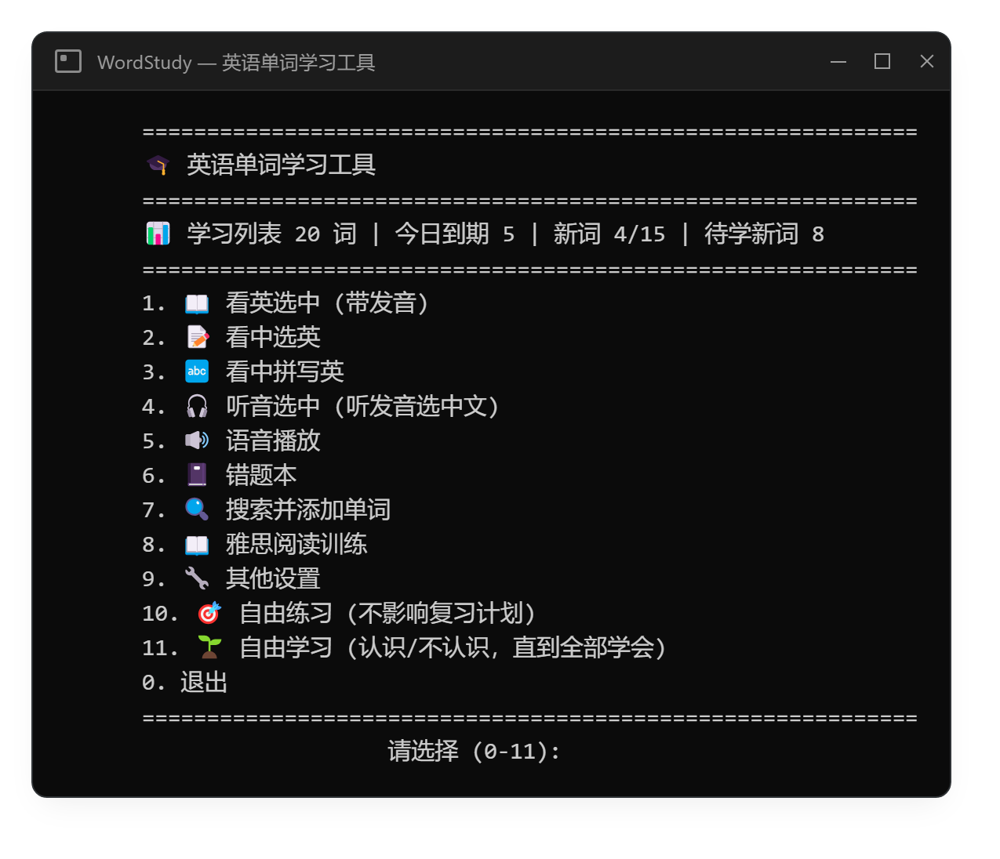
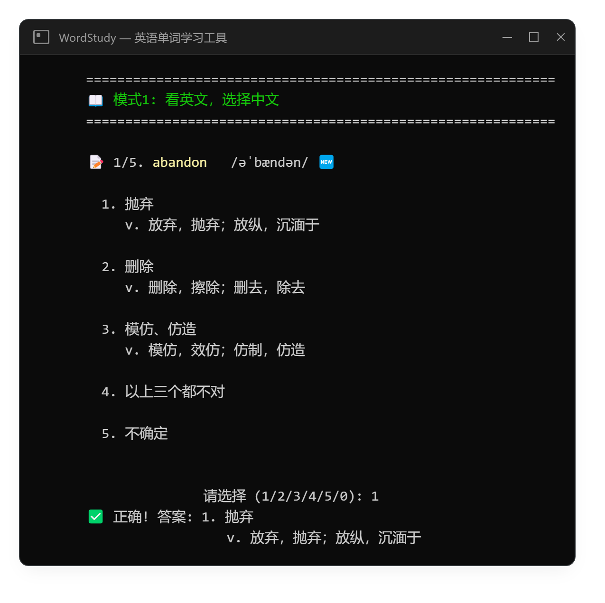

# WordStudy · Terminal Vocabulary Trainer

> A Windows terminal app for learning English vocabulary: **FSRS spaced repetition + Edge TTS pronunciation + 14 word books + an IELTS reading trainer**.
> Fully keyboard-driven, no GUI dependencies — learn, review, listen, spell and practise reading in one window.

<p>
  
  
  
  
</p>

**English** | [简体中文](README.md)

> The program interface is in Chinese; menu items below include their on-screen Chinese labels.

---

## 🖼️ Screenshots

<p align="center">
  
  <br>
  
</p>

---

## ✨ Features

### Six ways to study

| Mode | What you do | Best for |
| --- | --- | --- |
| 👂 English → meaning (看英选中) | See the word, hear it, pick the right Chinese meaning from 4 options | Learning new words |
| 📝 Chinese → English (看中选英) | See the meaning, pick the right English word | Daily review |
| ✏️ Chinese → spelling (看中拼写英) | See the meaning, type the English word letter by letter | Spelling practice |
| 🎧 Audio → meaning (听音选中) | Hear the word only, pick the correct meaning | Listening practice |
| 🎯 Free practice (自由练习) | Random words, **does not touch your review schedule** | Drilling stubborn words |
| 🌱 Free learning (自由学习) | Judge each word "known / unknown"; unknown ones show meaning + example and come back until all are learned | Fast pass over a list |

Options are shuffled every time; a wrong answer reveals the correct one immediately, and the result is converted into an FSRS rating from correctness and answer speed — no manual difficulty picking.

### 🧠 FSRS scheduling
- Built on [py-fsrs](https://github.com/open-spaced-repetition/py-fsrs) (stability / difficulty model), not a fixed interval table
- **Words imported today are mandatory**: they lead the session and bypass the daily new-word quota; after that, due reviews come first, then new words up to the quota
- When due reviews and new words run short the session is topped up with words learned today or with shaky memories
- Wrong → `Again` (rescheduled at once); correct but slow or replayed → `Hard`; normal correct → `Good`
- A new word answered correctly comes back the next day, then FSRS takes over
- Adjustable target retention (default **0.90**), max interval 3650 days, leeches flagged automatically
- Daily new-word limit (default 15) and session size are configurable

### 📚 Built-in word books
`word_learn.db` ships with the repository, ready to use:

| Category | Books |
| --- | --- |
| Postgraduate entrance exam (考研) | 2024 / 2025 / 2026 vocabulary, Red Book, syllabus 5530, core 2700 |
| CET-4 / CET-6 | CET-4 syllabus 5278, CET-6 syllabus 5278, CET core 2700 |
| IELTS | New Oriental IELTS 7000 |
| Gaokao / Zhongkao | Gaokao 3500, junior-high core |
| General | Oxford 3000 / 5000, COCA 20000 high-frequency |

**14 books, 20,780 entries, 72k book-word links.** Search books in Chinese or English, filter by level (primary school → IELTS), browse with paging, and the app remembers your last selection.

### 🔊 Pronunciation & listening
- American English via **Edge TTS** (`en-US-AriaNeural` / `en-US-GuyNeural`)
- Audio is cached under `data/tts_cache/` by voice, speed and text — each word is synthesised once and replays offline
- Adjustable playback speed, example-sentence playback, today's-words loop, and built-in English stories (*The Little Prince*, *The Three Little Pigs*, …)

### 📖 IELTS reading trainer
- Exam-style flow: pick a paper → read the passage in a split view → answer question by question → get scored → review mistakes
- Terminal reader with the passage on the left and a dictionary pane on the right — **double-click a word to look it up**
- Covers single/multiple choice, TRUE/FALSE/NOT GIVEN, YES/NO/NOT GIVEN, matching, classification, summary/sentence/table/diagram completion and short answers
- The question bank is not bundled: run `python import_reading.py` to download 200+ passages (~2,800 questions) from [hwttop5/ielts-reading-past-papers](https://github.com/hwttop5/ielts-reading-past-papers)

### 📓 Wrong-answer notebook
Missed words are collected automatically. Browse today's or all mistakes, or drill only the missed words — they still update your FSRS schedule.

### 🔍 Search & import
- Precise search: exact match first, then prefix matches, instead of dumping every word that contains the query
- Multi-select and add (`1,3,5`) to the study list in one go
- **PDF word lists**: parse English words and Chinese meanings straight from a PDF, overwrite the local entries and add them to your study list; page numbers, phonetics and headers/footers are skipped

### 📊 Progress & settings
The main menu shows the number of words in your list, how many are due, today's new-word progress, how many new words remain, and today's consolidation words. Session size, daily new-word limit, target retention and TTS speed live under **9. 其他设置** and are stored in `user_config.json`.

---

## 🚀 Quick start

**Requirements**: Windows 10/11, Python 3.10+, internet access (first TTS synthesis, reading-bank import)

```bash
git clone https://github.com/StarShine761/WordStudy.git
cd WordStudy
python -m venv .venv
.\.venv\Scripts\python.exe -m pip install -r requirements.txt
```

Launch (either way):

```bash
start.bat                  # recommended: UTF-8, colours, 72x34 centred window
.\.venv\Scripts\python.exe word_study.py
```

First run:

1. Press `7` to search and add words (pick a word book first — the choice is remembered)
2. Press `1` to start learning; missed words go to the wrong-answer notebook
3. From then on, open the app and work through what the menu reports as due

### Main menu

```
1.  📖 English → meaning (with audio)
2.  📝 Meaning → English
3.  🔤 Meaning → spelling
4.  🎧 Audio → meaning
5.  🔊 Audio playback
6.  📓 Wrong-answer notebook
7.  🔍 Search & add words
8.  📖 IELTS reading trainer
9.  🔧 Settings
10. 🎯 Free practice (does not affect the schedule)
11. 🌱 Free learning (known / unknown until all learned)
0.  Quit
```

---

## 📂 Project layout

```
WordStudy/
├─ word_study.py         # main program: menus, study modes, TTS, notebook, settings
├─ srs/                  # FSRS core
│  ├─ scheduler.py       #   rating policy + scheduler wrapper
│  ├─ queue.py           #   due / new / consolidation session assembly
│  ├─ quiz.py            #   distractor generation
│  ├─ store.py           #   card & review-log persistence
│  └─ schema.py          #   database schema
├─ wordstudy/            # installable package entry point
├─ reading_viewer.py     # terminal reader: split view, double-click lookup
├─ reading_exam.py       # exam UI: scrolling page, answering, scoring
├─ reading_practice.py   # paper selection, reading session, mistake log
├─ import_reading.py     # download & import the IELTS reading bank
├─ rebuild_vocab_db.py   # rebuild word_learn.db from open word lists
├─ meaning_format.py     # render meanings by part of speech
├─ word_learn.db         # vocabulary: 14 books / 20,780 entries
├─ requirements.txt
├─ start.bat / start.ps1
└─ test_*.py             # unit tests
```

## 💾 Data files

| File | Committed | Purpose |
| --- | --- | --- |
| `word_learn.db` | ✅ | Vocabulary database, shipped with the repo |
| `word_study.db` | ❌ | Your progress: study list, FSRS state, mistakes, reading bank, answer log |
| `user_config.json` | ❌ | Personal settings: session size, playback speed, … |
| `data/` | ❌ | Backups, raw word lists, TTS cache, reading-bank sources |

`word_study.db`, `user_config.json` and `data/` are listed in `.gitignore`, so your progress is never committed. Delete `word_study.db` to start over.

## 🔧 Vocabulary sources

`word_learn.db` is generated by `rebuild_vocab_db.py` from these open word lists:

- [exam-data/NETEMVocabulary](https://github.com/exam-data/NETEMVocabulary), [exam-data/CETVocabulary](https://github.com/exam-data/CETVocabulary) — postgraduate and CET-4/6 syllabus vocabulary
- [RealKai42/qwerty-learner](https://github.com/RealKai42/qwerty-learner) — Red Book, IELTS, Oxford, COCA and more
- [skywind3000/ECDICT](https://github.com/skywind3000/ECDICT) — phonetics and definition fallback

```bash
python rebuild_vocab_db.py      # rebuild (the old DB is backed up to data/backup/)
python import_reading.py        # download and import the IELTS reading bank
```

Copyright of the entries belongs to the original word-list / word-book authors; this repo only merges them for personal study.

## ❓ FAQ

**No sound?**
The first synthesis needs internet; check your default audio device. Synthesised words are cached and replay offline.

**Garbled Chinese or emoji?**
Launch with `start.bat` (it switches to UTF-8 and enables VT colours), or run `chcp 65001` in PowerShell first.

**`word_learn.db` not found?**
Make sure the clone is complete (about 15 MB), or regenerate it with `python rebuild_vocab_db.py`.

**macOS / Linux?**
Not supported. The app relies on Windows console APIs (`ctypes` + `winmm`) for centred layout, mouse word lookup and audio playback.

**How do I add more word books?**
Put the lists as JSON under `data/wordlists/` and extend `rebuild_vocab_db.py`, or use **7.2 Import from PDF** to add words on the fly (words missing from the local vocabulary DB are inserted automatically).

## 🧪 Tests

```bash
.\.venv\Scripts\python.exe -m unittest test_choice_prompt.py test_meaning_format.py
```

## 📄 License

Code is released under the [MIT License](LICENSE). Vocabulary and reading-bank content remains the property of its original sources.
